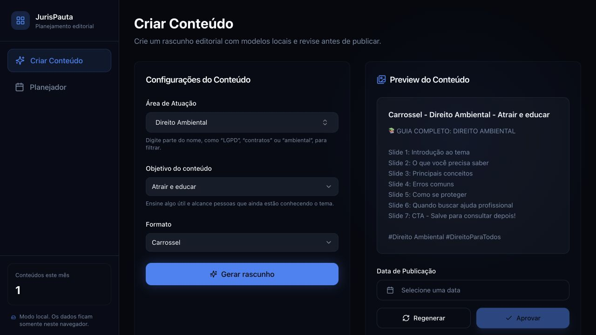
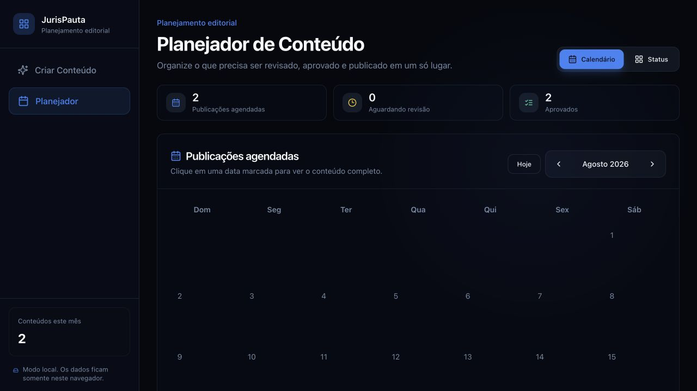
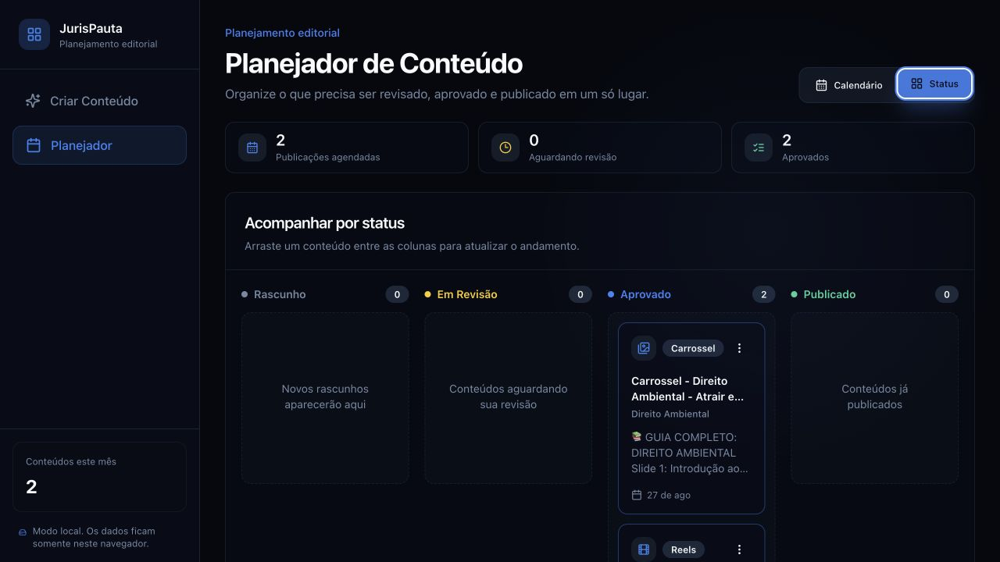

<div align="center">

# JurisPauta

**Planejamento editorial jurídico, local e open source.**

Transforme uma ideia em rascunho, organize a revisão e enxergue o calendário de publicações — sem conta, backend ou envio de dados para terceiros.

[](https://github.com/jpzank/jurispauta/actions/workflows/ci.yml)    

[**Abrir a demo pública**](https://jurispauta.vercel.app/) · use somente dados fictícios

</div>



## O que é

O **JurisPauta** é uma aplicação web para planejar conteúdo jurídico informativo. Você escolhe uma área do Direito, define o objetivo e o formato, revisa um rascunho local e agenda a publicação em um calendário editorial.

A versão atual usa **modelos determinísticos executados no navegador**. Não existe provedor de IA, servidor, banco de dados, login ou coleta de dados conectado ao app.

> [!IMPORTANT]
> Todo rascunho precisa de revisão humana antes de ser publicado. O JurisPauta não oferece aconselhamento jurídico, não verifica a legislação aplicável e não promete resultados.

## Para quem é útil

- **Advogados e advogadas autônomos** que desejam organizar uma rotina de conteúdo educativo.
- **Pequenos escritórios** que precisam visualizar pautas, revisões e datas em um só lugar.
- **Times de conteúdo jurídico** que querem prototipar um fluxo editorial simples.
- **Estudantes, designers e desenvolvedores** interessados em legaltech, privacidade local e software open source.
- **Contribuidores** que queiram evoluir uma base React para exportação, testes, acessibilidade ou integrações futuras.

## O que já funciona

- busca por dezenas de áreas jurídicas organizadas por grupo;
- escolha do objetivo: educar, aprofundar confiança ou apresentar uma atuação;
- rascunhos locais para Reels, Carrossel e Stories;
- agendamento de conteúdo em um calendário mensal;
- reagendamento direto no quadro por status;
- acompanhamento por status: Rascunho, Em revisão, Aprovado e Publicado;
- persistência no `localStorage` do navegador;
- consistência entre abas com gravações serializadas quando o navegador oferece Web Locks;
- validação de formato e tamanho antes da gravação;
- mudança de status por teclado ou arrastar e soltar;
- layout responsivo para desktop e telas menores;
- documentação de segurança, privacidade e contribuição.

## O produto em três telas

### 1. Crie e revise o rascunho

Na tela de abertura acima, você escolhe a área jurídica, o objetivo e o formato. O preview aparece ao lado para revisão antes de entrar no planejamento.

### 2. Enxergue o calendário editorial

Conteúdos aprovados aparecem na data agendada, com um resumo do volume e do estágio atual.



### 3. Acompanhe o andamento

A visão por status mostra o que ainda é rascunho, o que aguarda revisão e o que já foi aprovado ou publicado.



> Todas as capturas usam exemplos fictícios e foram produzidas a partir da aplicação em execução.

## Como funciona

1. Selecione uma área de atuação.
2. Escolha o objetivo editorial e o formato.
3. Gere e revise o rascunho local.
4. Defina uma data e aprove o conteúdo.
5. Acompanhe o calendário ou mova o item entre os status.

O JurisPauta ajuda a organizar o processo. A publicação em redes sociais continua sendo uma ação humana e externa ao aplicativo.

## Rodando localmente

### Requisitos

- Node.js 22 ou superior;
- npm;
- navegador moderno.

### Instalação

```bash
git clone https://github.com/jpzank/jurispauta.git
cd jurispauta
npm ci
npm run dev
```

Abra a URL mostrada pelo Vite, normalmente `http://localhost:8080`.

Não é necessário criar `.env`, configurar serviços externos ou cadastrar uma conta.

## Comandos

| Comando | Finalidade |
| --- | --- |
| `npm run dev` | Inicia o ambiente de desenvolvimento |
| `npm run lint` | Verifica o código com ESLint |
| `npm run typecheck` | Valida os tipos TypeScript |
| `npm test` | Executa os testes automatizados |
| `npm run test:watch` | Executa os testes em modo interativo |
| `npm run build` | Gera o build de produção |
| `npm run preview` | Abre uma prévia local do build |
| `npm audit --omit=dev` | Audita as dependências de produção |

## Stack

| Camada | Tecnologia |
| --- | --- |
| Interface | React 18 + TypeScript |
| Build | Vite 8 |
| Estilos | Tailwind CSS |
| Componentes | Radix UI e convenções do shadcn/ui |
| Ícones | Lucide React |
| Datas | date-fns |
| Persistência | `localStorage` |

## Dados e privacidade

Os conteúdos são armazenados na chave legada e versionada `lexcontent:contents:v1` do `localStorage`, preservada para não apagar pautas de quem já testou versões anteriores. Na arquitetura atual:

- os dados permanecem no mesmo navegador e perfil;
- outro dispositivo ou janela anônima começa vazio;
- nada é enviado a um backend ou provedor de IA;
- não existe sincronização, recuperação de conta ou backup automático;
- limpar os dados do site remove a cópia local e a mudança é refletida nas outras abas abertas.

> [!WARNING]
> `localStorage` não é um cofre criptografado. Não use processos, documentos, CPF, contratos, nomes de clientes ou qualquer informação protegida por sigilo profissional.

Leia [docs/PRIVACY.md](docs/PRIVACY.md) e [SECURITY.md](SECURITY.md) antes de ampliar o uso do projeto.

## Limitações atuais

- os rascunhos são baseados em modelos locais, não em um modelo de linguagem;
- o conteúdo não é checado contra leis, jurisprudência ou normas da OAB;
- os dados existem somente no navegador atual;
- não há colaboração entre usuários, autenticação ou histórico remoto;
- o app organiza a publicação, mas não publica diretamente em redes sociais;
- o projeto é um protótipo e não deve receber dados reais de clientes.

## Roadmap

Prioridades para as próximas versões:

- [x] testes automatizados para persistência e atualização de status;
- [x] feedback confiável para erros ou limites do armazenamento local;
- [ ] importação e exportação de pautas;
- [x] navegação por teclado para as principais ações do quadro;
- [x] experiência de reagendamento;
- [x] configuração de hospedagem com headers de segurança;
- [ ] auditoria WCAG completa com tecnologia assistiva;
- [ ] testes automatizados da interface do calendário;
- [ ] avaliação de uma integração opcional de IA por uma fronteira de servidor.

Uma integração futura de IA deve manter chaves privadas fora do navegador, remover dados sensíveis, aplicar limites e informar claramente como os dados são tratados.

## Estrutura do projeto

```text
src/
├── components/
│   ├── calendar/      # calendário e quadro por status
│   ├── content/       # criação e preview dos rascunhos
│   ├── layout/        # navegação e estrutura das páginas
│   └── ui/            # componentes de interface
├── hooks/             # estado e operações de conteúdo
├── lib/               # validação e persistência local
├── pages/             # rotas da aplicação
└── types/             # tipos e catálogo de áreas jurídicas
```

## Como contribuir

Issues e pull requests são bem-vindos. Antes de contribuir:

1. leia [CONTRIBUTING.md](CONTRIBUTING.md);
2. use somente dados fictícios em exemplos e capturas;
3. rode `npm run lint`, `npm run typecheck`, `npm test` e `npm run build`;
4. mantenha qualquer segredo ou integração externa fora do frontend;
5. explique o comportamento alterado e como ele foi verificado.

Para vulnerabilidades ou exposição de dados, siga [SECURITY.md](SECURITY.md) e não publique segredos em uma issue.

## Princípios do projeto

- **Revisão humana:** um rascunho nunca é tratado como conteúdo final.
- **Privacidade por padrão:** nenhum dado precisa sair do navegador.
- **Clareza:** linguagem simples antes de jargão técnico ou de marketing.
- **Responsabilidade:** nada de promessas de resultado ou aconselhamento jurídico automatizado.
- **Evolução aberta:** decisões e melhorias devem ser documentadas para a comunidade.

## Licença

Distribuído sob a [licença MIT](LICENSE). Consulte também os [avisos de terceiros](THIRD_PARTY_NOTICES.md).
